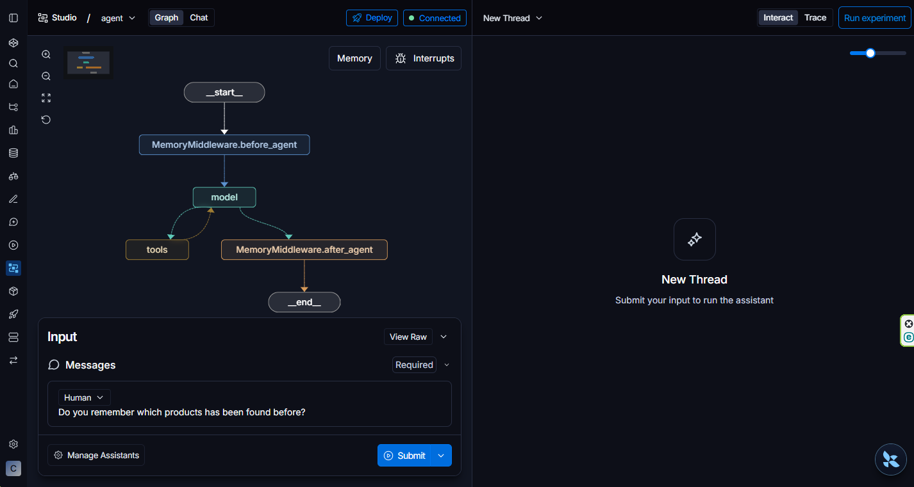

# Web Agent in LangGraph

Web Agent is a sophisticated and flexible Product Research Assistant built with LangGraph, designed to intelligently browse the web and extract structured product information. It combines real-time web browsing with persistent long-term memory and semantic search to help users research products efficiently across multiple sessions.

The agent navigates web pages, extracts detailed product data (name, brand, price, features, URLs), and stores everything in a structured format for future reference. It remembers past searches within conversations and across sessions, using intelligent semantic search to recall relevant discoveries without redundant browsing. With multi-user support, Trustcall-powered data extraction for accuracy, and deployment-ready integration with LangSmith Studio, Web Agent provides a complete solution for intelligent product research automation.

Visit the **Features** section below for detailed information on each capability.

## Features:

**Intelligent Web Browsing:**
Navigate and extract content from web pages using Playwright-powered browser automation. The agent can open URLs, read page content, and analyze product information across e-commerce sites.

**Structured Product Research:**
Automatically extract and organize product data including name, brand, category, price, URLs, and key features. Each product is stored in a standardized format for easy comparison and retrieval.

**Short-term Memory:**
The agent maintains conversation context within the same session. When using the same User ID, it remembers previous messages and can reference earlier queries without re-browsing.

**Long-term Memory with Semantic Search:**
All browsing journeys and product discoveries are persisted in PostgreSQL (via *langgraph dev* command). The agent performs intelligent semantic search to recall relevant past searches, enabling it to answer follow-up questions using previously gathered data without redundant web browsing.

**Multi-user Isolation:**
Each user gets a separate memory namespace using their User ID. This ensures privacy and allows multiple concurrent users to maintain independent browsing histories.

**Trustcall-powered Data Extraction:**
Uses the Trustcall library for LLM-driven structured extraction of product information. This ensures more accurate JSON field population compared to simple prompt-based instructions, reducing hallucinations and incomplete data.

**Memory-aware Responses:**
The agent automatically recalls related past journeys before answering. It intelligently detects when users are asking about history versus requesting fresh information, adapting its retrieval strategy accordingly.

**URL and Domain Tracking:**
Automatically tracks and stores all URLs visited and domains encountered during each browsing journey for audit trails and future reference.

**Utility Tools:**
Includes built-in tools for arithmetic calculations and UTC timestamp retrieval to support price comparisons and time-sensitive product research.

**LangSmith Studio Integration:**
Deploy and test the agent directly in LangSmith Studio with full execution traces, debugging information, and visual workflow inspection for easy development and iteration.

## Architecture


## Set Up

### Prerequisites

- Python 3.13 or later
- `uv` package manager (install from https://docs.astral.sh/uv/getting-started/)

### Step 1: Create a Virtual Environment

```bash
# Create a virtual environment
python -m venv venv

# Activate the virtual environment
# On macOS/Linux:
source venv/bin/activate
# On Windows:
venv\Scripts\activate
```

### Step 2: Install Dependencies

```bash
uv sync --all-groups
```

This installs all project dependencies including development tools and the LangGraph CLI.

### Step 3: Run LangSmith Studio

```bash
langgraph dev
```

This starts the local development server at `http://127.0.0.1:2024`. You can now:
- Interact with the agent through the web UI
- Test memory recall and browsing capabilities
- View execution traces and debugging information


