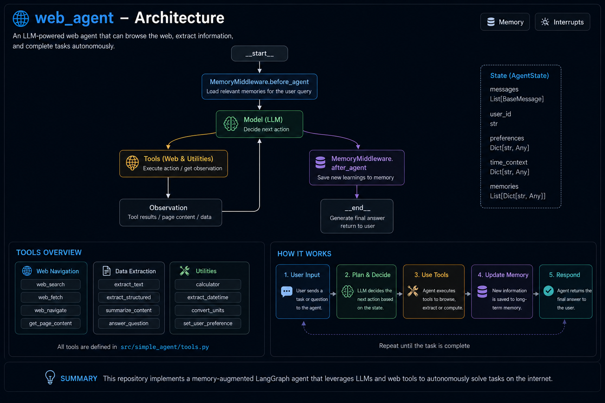

# Web Agent in LangGraph

Web Agent is a flexible up-to-date implementation in LangGraph capable of browsing the web to find products for the user.
It is basically a flexible Product Reseatch Assistant that can save the general information about a product in the web store the user describes in the request.
It can go to a specific URL or find it based on the user description, click and read through the content to find relevant information about the product or products it finds there.
It is deployable in LangSmith Studio to easily test and debug.

## Features:

**Short term memory:**
The agent will remember the previous message inside the same conversation when using the same value in "User Id" field (required).

**Long term memory:**
The Postgres storage the *langgraph dev* command adds when packaging the LangGraph project saves the product information and the previous requests in a JSON structure that can be easily read and used for future features.

**Trustcall:**
This library is used for the LLM to have the capability to read through the browsing results and extract the values of the JSON fields in a more accurate way than just instructing it as part of the system prompt.

## Architecture



## Set Up

### Prerequisites

- Python 3.13 or later
- `uv` package manager (install from https://docs.astral.sh/uv/getting-started/)

### Step 1: Create a Virtual Environment

```bash
# Create a virtual environment
python -m venv venv

# Activate the virtual environment
# On macOS/Linux:
source venv/bin/activate
# On Windows:
venv\Scripts\activate
```

### Step 2: Install Dependencies

```bash
uv sync --all-groups
```

This installs all project dependencies including development tools and the LangGraph CLI.

### Step 3: Run LangSmith Studio

```bash
langgraph dev
```

This starts the local development server at `http://127.0.0.1:2024`. You can now:
- Interact with the agent through the web UI
- Test memory recall and browsing capabilities
- View execution traces and debugging information

